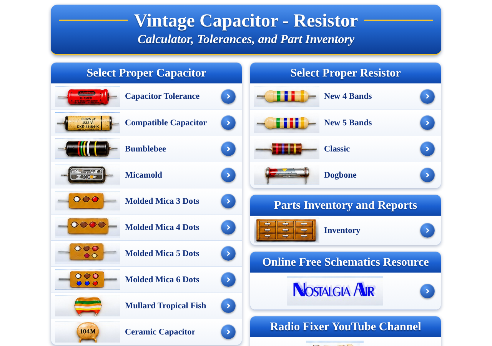
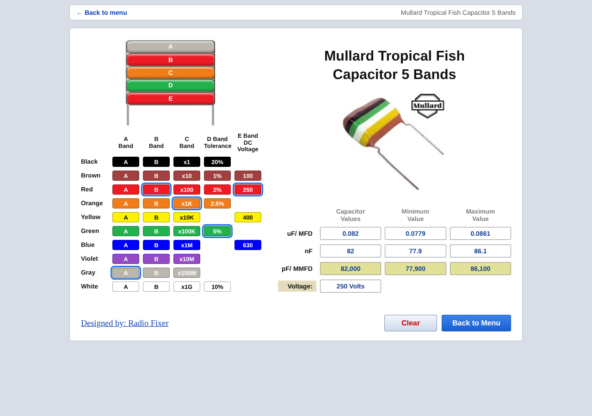
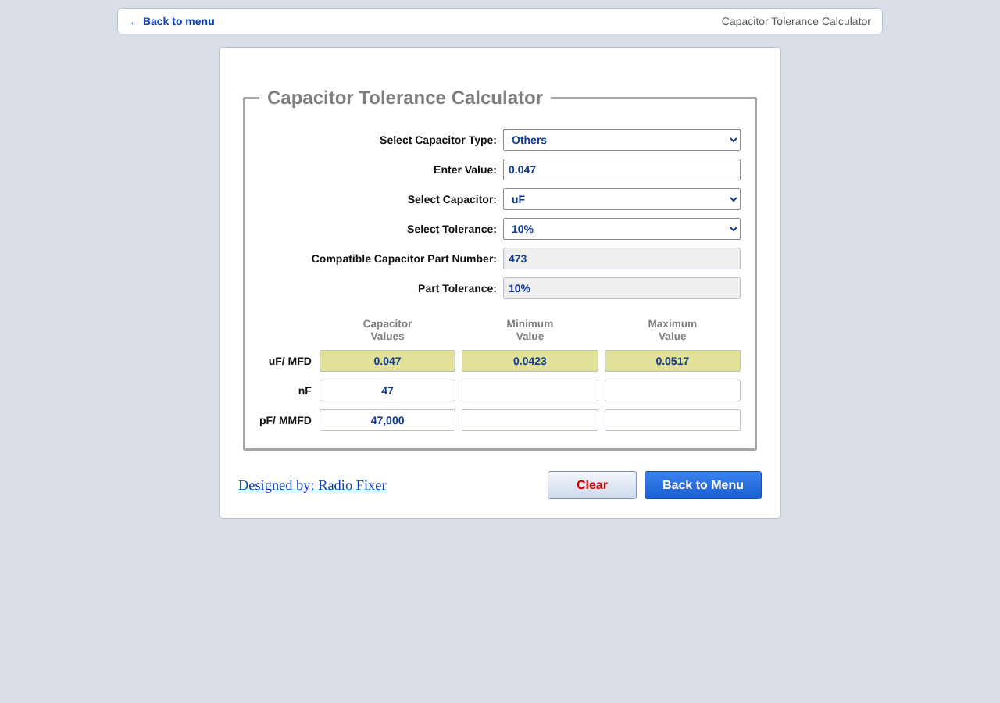

  

<h1 align="center">Radio Fixer</h1>

  <b>Vintage capacitor &amp; resistor calculators, tolerances, and a parts inventory — for people who restore old radios.</b> 
  Windows and Mac · Works offline · Your inventory stays on your computer

  <a href="https://github.com/RadioFixerAp/RadioFixer-Downloads/releases/latest"><b>⬇️ Download the latest version</b></a>

---

## What's inside

**Capacitor calculators**

- Capacitor Tolerance — minimum / maximum values in µF, nF and pF
- Compatible Capacitor — find a modern film replacement for a vintage paper capacitor
- Bumblebee (Sprague) color code, with tolerance and voltage
- Micamold, and Molded Mica 3-, 4-, 5- and 6-dot color codes
- Mullard "Tropical Fish" (C280) color code
- Ceramic capacitor codes (e.g. 104M, 472J, 4R7)

**Resistor calculators**

- New 4-band and 5-band color codes
- Classic brown resistors
- Dogbone (body–end–dot) resistors

**Parts inventory** — keep track of your vacuum tubes, capacitors, resistors and other parts: search, sort, edit, reports, Excel/CSV import and export, and backup / restore.

**Handy links** — the Radio Fixer YouTube channel and the free NostalgiaAir schematics library.

| | |
|---|---|
|  |  |

## Try it free for 48 hours

- **Inventory and the outside links are always free.**
- **All calculators are free for 48 hours**, counted from the first time you open a calculator — not from when you download.
- After the trial, buy a **lifetime license, including all future updates**:
  - **$14.99** if you buy during your 48-hour trial
  - **$19.99** after the trial ends
- Pay securely with **PayPal** (PayPal account or debit/credit card) using the **Buy with PayPal** button inside the app. Your personal unlock code arrives by email, usually within 24 hours.

## Download and install

Go to **[Releases → Latest](https://github.com/RadioFixerAp/RadioFixer-Downloads/releases/latest)** and, under **Assets**, download the **one** file for your computer:

| Your computer | Download this file |
|---|---|
| 🪟 **Windows 10 or Windows 11** | **`RadioFixer-…-Windows-10-11-Setup.exe`** |
| 🍎 **Any Mac** — older Intel Macs **and** newer Apple-chip Macs (M1, M2, M3, M4…) | **`RadioFixer-…-Mac-Intel-and-Apple-chip.dmg`** |

There is just one file for Windows and one for Mac, so you don't need to know which model or chip you have.

> **Not sure?** On Windows, the **Start** button in the lower-left (or center) of the screen means Windows. On a Mac, the **** menu in the top-left corner means Mac.
>
> **Requirements:** Windows 10 or 11 (64-bit) · macOS 10.13 High Sierra or newer. The first install on Windows may need an internet connection to add Microsoft's free WebView2 component, if it isn't already on your PC.

### Windows

1. Double-click the downloaded **`RadioFixer-…-Windows-10-11-Setup.exe`**.
2. If Windows shows **"Windows protected your PC"**, click **More info**, then **Run anyway**.
   *(This appears because Radio Fixer is a small independent program that isn't registered with Microsoft — it's normal.)*
3. Follow the installer. Radio Fixer appears on your desktop and in the Start menu.

### Mac

1. Double-click the downloaded **`RadioFixer-…-Mac-Intel-and-Apple-chip.dmg`** and drag **Radio Fixer** into your **Applications** folder.
2. Open Radio Fixer. If macOS says it **can't be opened** or **can't be verified**, click **Done**.
3. Open **System Settings → Privacy & Security**, scroll down to **Security**, and click **Open Anyway** next to Radio Fixer. Enter your Mac password if asked, then click **Open Anyway** again.
4. You only need to do this once.

### Updating

Download and install the newest version the same way. Your inventory and your unlock stay in place.

## Your inventory is private

Your inventory is stored **on your own computer**, not online, and is never sent to Radio Fixer. Use **Inventory → Backup, Restore & Export** to keep a copy on a USB drive or to move it to another computer.

## Need help?

- Email: **radiofixer@yahoo.com**
- YouTube: **[@RadioFixer](https://www.youtube.com/@RadioFixer)**

If your unlock code hasn't arrived within 24 hours of payment, please check your spam folder, then email us with the email address you used to pay.

---

© Radio Fixer. All rights reserved. This page provides the Radio Fixer installers only; the program's source code is not published.
